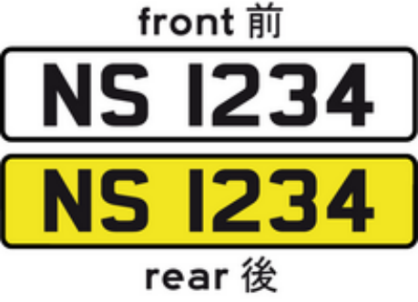
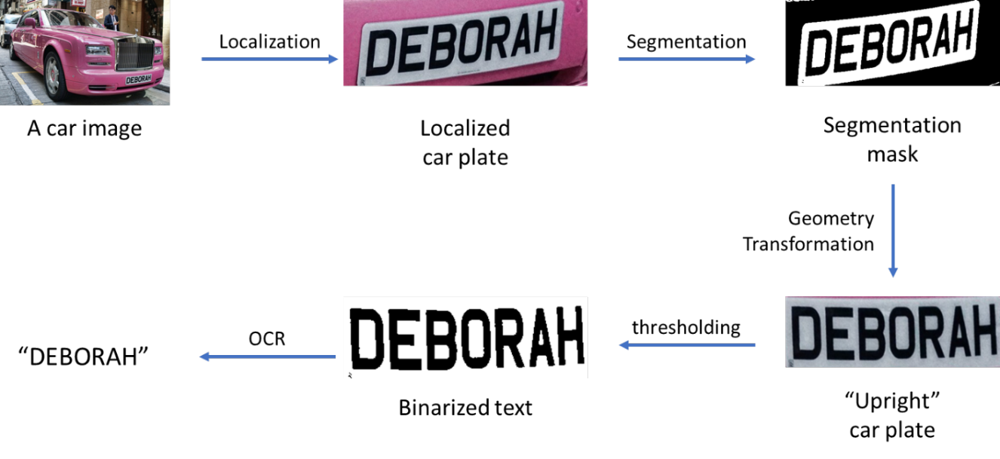

<!-- page 1 of 5 -->

# Project - License Plate Recognition

## Introduction

License Plate Recognition (LPR) is a widely-used technology with applications in areas such as traffic law enforcement, parking management, highway toll collection, and vehicle tracking. The development of an efficient and robust LPR system involves challenges in computer vision, image processing, and machine learning, as it requires the identification and extraction of license plate regions and the accurate interpretation of characters under varying real-world conditions.

In this project, you will design and implement a complete LPR system specifically for Hong Kong vehicle license plates. According to Hong Kong regulations, license plates are standardized in terms of format: vehicles display a white-background license plate at the front and a yellow-background license plate at the rear. The license plates consist of alphanumeric characters that need to be extracted from real-world images of vehicles. These images will be captured in diverse environments and present challenging conditions such as varying illumination, camera angles, and image quality.

However, you are not allowed to assume any prior knowledge about the image’s viewing angle, the color of the vehicle, or lighting conditions, nor can you expect ideal contrast between the plate and its surroundings. What you can assume is that the images will always be in RGB color format and that the license plates will generally follow the color patterns defined by the Hong Kong Traffic Regulations.

Your goal is to develop a multi-step recognition pipeline that processes input images of vehicles to output the recognized license plate string. The pipeline must handle complex real-world scenarios, including geometric distortions, occlusions, and varying image quality. The system will be robust enough to work on images captured from different angles and under non-ideal lighting conditions, making it adaptable for practical deployments.

<!-- page 2 of 5 -->

## Project Motivation

Creating a fully functional LPR system is a challenging task that combines multiple disciplines, including image processing, computer vision, and machine learning. While commercial systems for license plate recognition are well-developed, they often rely on ideal conditions or specialized hardware, making them unsuitable for diverse environments such as urban traffic with unpredictable lighting, weather, or camera placement.

This project aims to give students hands-on experience in building a functional LPR pipeline from scratch, focusing on Hong Kong vehicle license plates as a target case study. The choice of Hong Kong plates introduces an additional level of complexity due to their distinct front (white) and rear (yellow) background colors, as well as their high contrast alphanumeric characters.

You are expected to:

- Explore different steps of the pipeline, such as license plate localization, segmentation, geometric correction, and character recognition.

- Handle the unpredictability of real-world inputs, including non-ideal camera angles, variable lighting conditions, shadows, reflections, and occlusions.

- Develop solutions that are not reliant on simple assumptions such as the color of the vehicle or the orientation of the license plate in the image.

By the end of this project, you will have gained experience in solving real-world computer vision challenges and integrating various image processing techniques into a coherent system. The project encourages creativity and experimentation, allowing you to implement custom solutions and explore advanced methods such as deep learning, contour-based segmentation, and perspective transformations.

The main goals of the project are as follows:

1. Build a robust system for detecting and recognizing Hong Kong vehicle license plates in RGB images.

2. Overcome challenges related to varying camera angles, imperfect lighting, and deformations in the input images.

3. Implement or integrate existing solutions for character recognition and geometric transformations to increase recognition accuracy.

The project will not only challenge your technical skills but also your ability to design and fine-tune a system that can generalize across varied input conditions. In addition to completing the core requirements, additional bonus marks will be awarded for innovative and efficient solutions, encouraging the pursuit of more advanced or novel approaches such as training deep learning models or improving segmentation accuracy.

<!-- page 3 of 5 -->

In this project, we will use a structured pipeline to perform **license plate recognition**. The pipeline is designed to break down the problem into smaller, manageable steps, each addressing a key aspect of the recognition process. The fundamental stages of the pipeline are as follows:

### Localization of the license plate (detection)

Detect the location of the license plate in the input image.

### Extraction of the license plate (segmentation)

Isolate the license plate area from the rest of the image.

### Geometric transformation of the license plate

Correct any perspective distortions or misalignments to standardize the plate’s geometry for better recognition.

### Character recognition (OCR)

Recognize the characters on the license plate and output the plate number as a string.

These steps represent the backbone of the project, and you **cannot remove any of them** in your solution. However, you are free to add **additional steps** (preprocessing or postprocessing) to enhance performance, improve robustness, or handle edge cases. For example, you might choose to implement preprocessing steps for noise reduction or contrast enhancement, or postprocessing steps to improve the final OCR accuracy. As long as the required steps are not bypassed, you have the flexibility to modify or expand the pipeline to suit your approach.

### A detailed description of the pipeline

Firstly, we show general graphics of the pipeline.

<!-- page 4 of 5 -->

There are multiple ways to achieve each step in the pipeline. For example, you might use different algorithms to detect the license plate, different methods to extract the relevant regions, and different techniques to recognize the characters. We encourage you to explore various methods and choose the ones that best suit the problem at hand. You should also feel free to experiment with custom solutions or combinations of approaches that improve the overall accuracy and robustness of your system.

## Grading Criteria and Use of Third-Party Libraries

Your grade will be based on the **quality of your results** and the **effort** and **insight** you demonstrate in your design. While the use of third-party libraries is allowed, relying solely on pre-existing solutions for the entire project will limit your ability to earn full marks. Implementing certain steps (or portions of them) yourself, rather than using off-the-shelf solutions, will allow you to demonstrate deeper understanding and technical skill.

- If your solution is primarily built on third-party libraries, you will still be graded on how well you integrate and apply them, but you may not achieve full marks for the methodology.

- To earn higher marks, we encourage you to align with the suggested pipeline and later introduce your own customizations on the pipeline. Suppose your solution is simply based on end-to-end methodologies without the step-by-step decomposition of the complete problem, you may receive a relatively lower grade.

Ultimately, the grading for this section will reward not only the correctness of the final system but also your ability to develop and tailor a complete, end-to-end pipeline for license plate recognition, demonstrating both insight and creativity.

<!-- page 5 of 5 -->

## Grading Criteria

- Code execution status: **40%**

- Report completeness: **30%**

- On-site presentation performance: **30%**

### Submission

### Submission Guidelines

- The **final presentation** will take place from **Week 11 (tentatively)**. Part-time students are suggested to present on Teams during the presentation time, or you need to contact me in advance to reserve other time slots. The instructor will arrange the order of presentation based your group information.

- Your final submission package must include:

  - Your **Jupyter notebook** (sharable links if you work on Colab, or the ipynb file, or .py source codes) containing the complete implementation.

  - A **PDF report** detailing the system (methodology, results, etc.).

  - At least 4 examples of successful cases and 2 examples of challenging/failed cases.

### Deadline

- All documents including your source code and report should be submitted to the Moodle before 12:00 noon on December 18, 2026.
