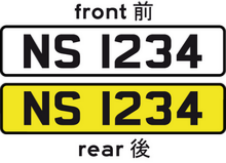
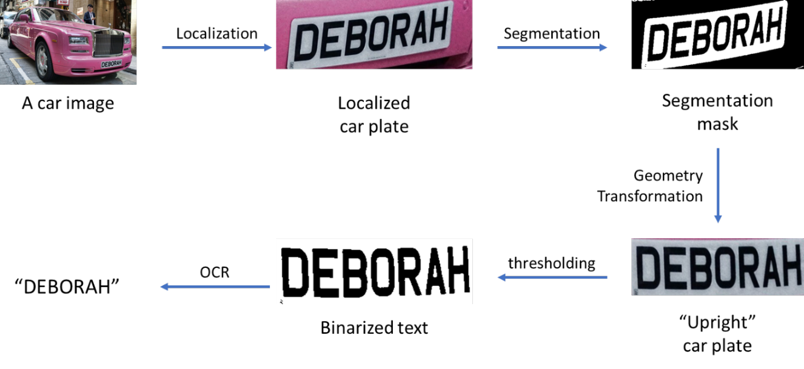
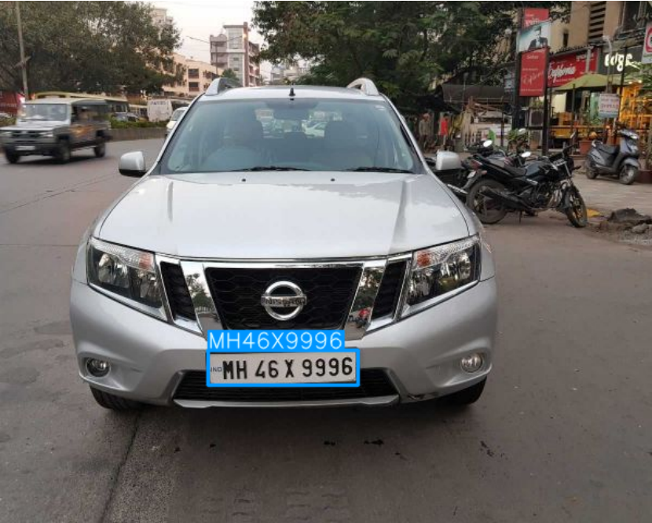

<!-- page 1 of 5 -->

# 專題 — 車牌辨識

## 簡介

車牌辨識（License Plate Recognition, LPR）是一項廣泛應用的技術，可運用於交通執法、停車場管理、高速公路收費以及車輛追蹤等領域。要開發一套有效率且強健的 LPR 系統，必須克服電腦視覺、影像處理與機器學習方面的挑戰，因為它需要在各種真實世界條件下，辨識並擷取車牌區域，並準確解讀其上的字元。

在本專題中，你將設計並實作一套專門針對香港車牌的完整 LPR 系統。依據香港法規，車牌格式已有標準化規範：車輛前方懸掛白底車牌，後方懸掛黃底車牌。車牌由英文字母與數字組成，必須從真實世界的車輛影像中擷取出來。這些影像拍攝於多樣化的環境，並會呈現光照變化、拍攝角度、影像品質等具挑戰性的狀況。

然而，你不得預設任何關於影像視角、車身顏色或光照條件的既有知識，也不能期待車牌與其周遭環境之間存在理想對比。你可以假設的是：影像一律為 RGB 色彩格式，且車牌大致符合香港《道路交通條例》所定義的顏色樣式。

你的目標是開發一套多步驟的辨識流程，處理輸入的車輛影像並輸出辨識出的車牌字串。此流程必須能應付複雜的真實情境，包括幾何變形、遮蔽以及多變的影像品質。系統必須足夠強健，能處理不同角度與非理想光照條件下拍攝的影像，使其適合實際部署。

<!-- page 2 of 5 -->

## 專題動機

打造一套完整可用的 LPR 系統是一項具挑戰性的任務，結合了影像處理、電腦視覺與機器學習等多個學門。雖然商用車牌辨識系統已相當成熟，但它們往往依賴理想條件或專用硬體，因而難以適用於多樣化的環境，例如光照、天候或攝影機架設位置皆難以預測的城市交通場景。

本專題旨在讓學生從零開始親手建構一套可運作的 LPR 流程，並以香港車牌作為目標案例研究。選擇香港車牌會額外增加一層複雜度，因為它們具有獨特的前方（白底）與後方（黃底）背景顏色，以及高對比的英數字元。

你應當做到：

- 探索流程中的各個步驟，例如車牌定位、分割、幾何校正與字元辨識。

- 處理真實世界輸入的不可預測性，包括非理想的拍攝角度、變動的光照條件、陰影、反光與遮蔽。

- 開發不依賴簡單假設（例如車身顏色或車牌在影像中的方向）的解決方案。

完成本專題後，你將累積解決真實電腦視覺挑戰、並將各種影像處理技術整合為一套連貫系統的經驗。本專題鼓勵創意與實驗，讓你能實作自訂方案，並探索深度學習、輪廓式分割、透視變換等進階方法。

本專題的主要目標如下：

1. 建構一套強健的系統，能在 RGB 影像中偵測並辨識香港車牌。

2. 克服拍攝角度變化、光照不完美以及輸入影像變形等相關挑戰。

3. 實作或整合既有的字元辨識與幾何變換方案，以提升辨識準確度。

本專題不僅考驗你的技術能力，也考驗你設計並調校一套能泛化於各種輸入條件的系統的能力。除完成核心要求外，創新且高效的解決方案還可獲得額外加分，以鼓勵追求更進階或更新穎的做法，例如訓練深度學習模型或提升分割準確度。

<!-- page 3 of 5 -->

本專題將採用結構化的流程來執行**車牌辨識**。此流程的設計是將問題拆解為數個較小、易於處理的步驟，每個步驟各自負責辨識過程中的一個關鍵面向。流程的基本階段如下：

### 車牌定位（偵測）

偵測輸入影像中車牌所在的位置。

### 車牌擷取（分割）

將車牌區域從影像其餘部分中分離出來。

### 車牌幾何變換

校正任何透視變形或位置偏差，將車牌的幾何形狀標準化，以獲得更好的辨識效果。

### 字元辨識（OCR）

辨識車牌上的字元，並以字串形式輸出車牌號碼。

這些步驟構成專題的骨幹，你的解決方案中**不得移除其中任何一個步驟**。不過，你可以自由加入**額外步驟**（前處理或後處理）以提升效能、增強強健性或處理邊界情況。例如，你可以實作降低雜訊或增強對比的前處理步驟，或實作提升最終 OCR 準確度的後處理步驟。只要不繞過必要步驟，你都可以彈性調整或擴充此流程，以符合你的做法。

### 流程的詳細說明

首先，我們展示此流程的整體示意圖。

<!-- page 4 of 5 -->

流程中的每個步驟都有多種實作方式。例如，你可能使用不同的演算法偵測車牌、以不同方法擷取相關區域，並以不同技術辨識字元。我們鼓勵你探索各種方法，並選擇最適合當前問題的做法。你也可以自由嘗試自訂方案，或組合多種做法，以提升系統整體的準確度與強健性。

## 評分標準與第三方函式庫的使用

你的成績將取決於**成果的品質**，以及你在設計中所展現的**努力**與**見解**。雖然允許使用第三方函式庫，但若整個專題僅依賴既有解決方案，將限制你取得滿分的機會。自行實作某些步驟（或其部分內容），而非直接使用現成方案，能讓你展現更深入的理解與技術能力。

- 若你的解決方案主要建立在第三方函式庫之上，我們仍會依據你整合與應用這些函式庫的程度評分，但在方法論方面可能無法獲得滿分。

- 若要取得更高分數，我們鼓勵你依循建議的流程，並在後續於此流程上加入你自己的客製化設計。假設你的解決方案僅採用端對端（end-to-end）方法，而未對完整問題進行逐步拆解，則可能獲得相對較低的分數。

最終，本部分的評分不僅獎勵最終系統的正確性，也獎勵你開發並調整一套完整、端對端車牌辨識流程的能力，展現見解與創意。

<!-- page 5 of 5 -->

## 評分標準

- 程式執行狀況：**40%**

- 報告完整度：**30%**

- 現場簡報表現：**30%**

### 繳交

### 繳交須知

- **期末簡報**將自**第 11 週（暫定）**開始進行。建議兼讀制學生於簡報時段在 Teams 上進行簡報，或需事先與我聯繫以預約其他時段。講師將依據你們的組別資訊安排簡報順序。

- 你的最終繳交檔案必須包含：

  - 你的 **Jupyter notebook**（若使用 Colab，可提供可分享的連結；或提供 ipynb 檔案；或 .py 原始碼），內含完整實作。

  - 一份詳細說明系統的 **PDF 報告**（方法論、結果等）。

  - 至少 4 個成功案例範例，以及 2 個具挑戰性／失敗案例範例。

### 截止日期

- 所有文件（含原始碼與報告）應於 2026 年 12 月 18 日中午 12:00 前繳交至 Moodle。