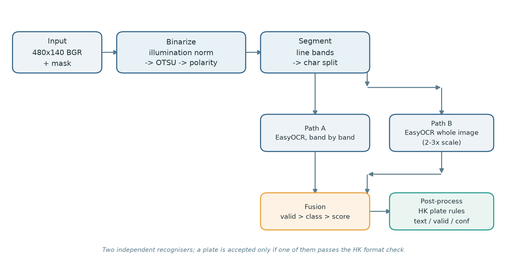
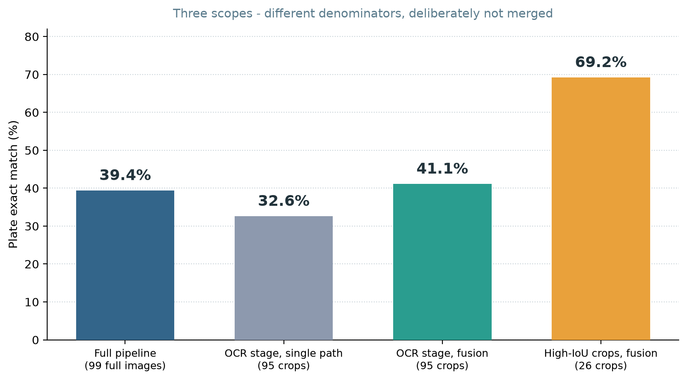
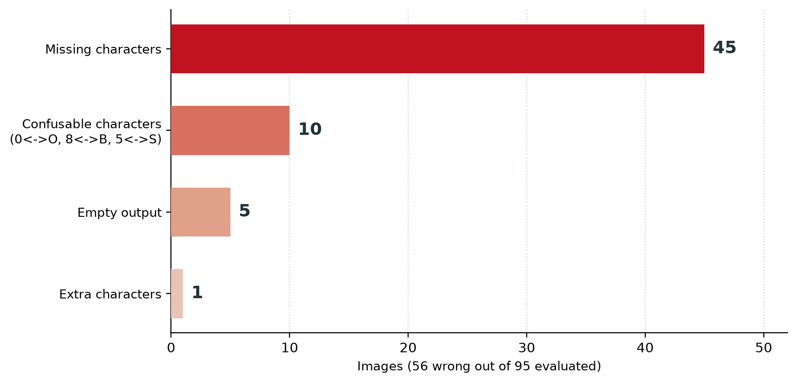

<!-- _class: lead -->
<!-- _footer: '' -->

# Hong Kong Licence Plate Recognition

## CIS342 Course Project - Group 6

### B-line: OCR, post-processing and integration

---

# A-line: image to a rectified crop

<!--
TODO(nok): replace this slide set with sections 0-4
(data overview, preprocessing, localisation, extraction and rectification).
Keep one h2 title per slide, 3-5 bullets, and put images in slides/assets/
named <section>-<content>.png.
-->

- placeholder: dataset and annotation
- placeholder: preprocessing and the locator
- placeholder: extraction and geometric correction

---

## From a rectified crop to a plate string

**Contract handed over by the A-line**

| Direction | Payload |
| --- | --- |
| A to B | `upright_bgr`: 480 x 140, BGR uint8 |
| A to B | `upright_mask`: 255 = real pixels, 0 = padded |
| B to A | `text`, `valid`, `conf` |

**Four stages we deliver**

- **§6** binarise, line bands, character split, recognition
- **§7** Hong Kong plate format validation and correction
- **§8** two-path integration and the dark-plate guard
- **§9** evaluation in three scopes

<!--
Never trust a single recogniser: two independent readings, the plate format
decides which one we keep, not the confidence score.
Every number carries its scope - the three denominators are never merged.
-->

---

## We own the split, we borrow the recogniser

Hong Kong plates use a stroke weight, aspect ratio and surface texture that no available font reproduces.
*Our synthetic CNN reaches 100% on its own training data and 0 out of 7 on real plates. The gap is in the glyph, not in the training.*

| §6 - 7 clean plate crops (upper bound of OCR) |  |
| --- | ---: |
| Hershey vector template matching | 0 / 7 |
| Custom CNN, synthetic (Hershey fonts) | 0 / 7 |
| Custom CNN, synthetic (7 Windows fonts) | 0 / 7 |
| EasyOCR whole image, no own segmentation | 5 / 7 |
| **Ours: own split + EasyOCR per line** | **7 / 7** |
| **§9 - rectified pipeline output** | **95 / 26 crops** |
| Single path, own split only | 32.6% / 61.5% |
| **Two-path fusion** | **41.1% / 69.2%** |

---

## Binarise, split, then let a trained reader read

- **One global threshold, not adaptive** - illumination normalisation plus one Otsu; adaptive mangled a clean crop
- **Bands first, characters second** - two-line and cross-border layouts share one splitter
- **Two readers, one decision** - band-by-band wins on clean crops, whole-image wins with bodywork

---

## Hong Kong plate grammar as a prior

| Class | Pattern | Example |
| --- | --- | --- |
| Standard | 2 letters + 102-9998, never I/O/Q | VF 9219 |
| Single letter | 1 letter + number (legacy) | B 281 |
| Personalised | up to 8 characters, at least one letter | BORACAY |
| Cross-border | 粤Z + 4 digits + 港 | 粤Z 6796 港 |

**What the post-processor does**

- Confusions become *candidates*, not certainty: O/0, I/1, S/5, B/8, Z/2, G/6
- Every candidate is scored by plate class; ties are broken by edit distance to the raw reading
- Two guards against over-acceptance: a standard-shaped string outside the number range is rejected, and a cross-border-shaped string is sent to the Chinese re-check
- Cross-border is allowed only on dark plates (median grey below 90 inside the mask) - a white plate must never become 粤Z

---

## Three scopes, reported separately

- **Different denominators, on purpose** - 99 images, 95 crops, 26 high-IoU crops; never merged
- **Fusion pays** - +8.5 points on 95 crops, +7.7 on the 26 crops
- **Geometry pays more** - 57.7% to 69.2% once GEO-01 replaced a plain resize
- **The upper bound** - 7/7 clean crops; the gap to 39.4% is localisation, not OCR

---

## Most errors are characters we never saw

- **45 of 56 wrong plates are missing characters** - never presented to the reader
- **Why** - the crop still holds bumper and bodywork; dark regions merge into the text band
- **Localisation is the ceiling** - of 69 images at IoU < 0.5, only 2.9% read correctly
- **Next step** - a position prior (letters first, digits last) and a tighter plate region
